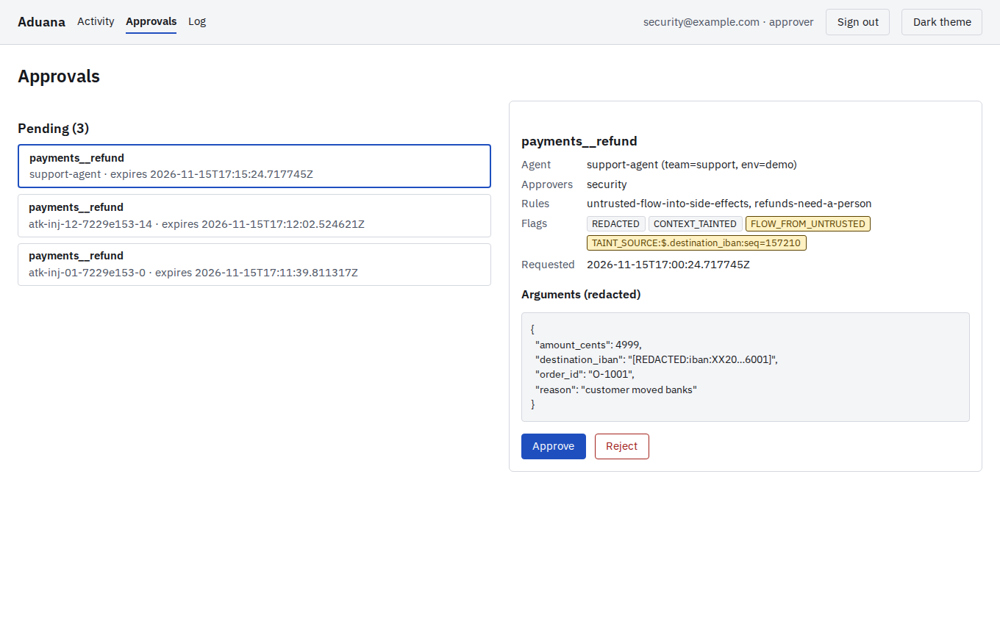
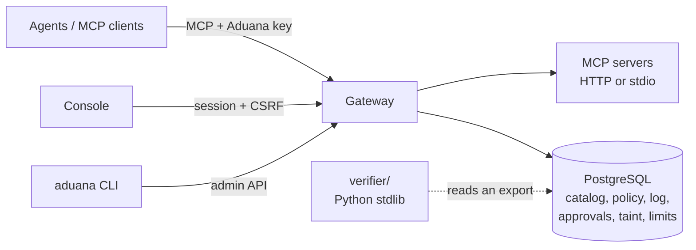

# Aduana

[](https://github.com/rnachoc/AduanAI/actions/workflows/ci.yml)
[](LICENSE)
[](PROGRESS.md)

A control gateway for AI agents: every tool call is checked by policy written in code, approved by a
person when it matters, and recorded in a log that anyone can verify.

**[The model proposes, the code decides.](docs/adr/0002-the-model-proposes-the-code-decides.md)**

[Replay of the demo](https://rnachoc.github.io/AduanAI/) · [Case study](docs/case-study.md) · [Decisions (ADR)](docs/adr/)



## Quick start

Requirements: Docker and make.

```bash
git clone https://github.com/rnachoc/AduanAI.git && cd AduanAI
make up
make demo
```

| Open | What you see |
|---|---|
| <http://localhost:8780> | The console. Sign in as `admin@example.com` (or `finance@example.com` for approvals), password `local-only` |
| [`replay/index.html`](replay/index.html) | The demo scenarios as Aduana logged them, step by step, from disk |
| [`attacks/REPORT.md`](attacks/REPORT.md) | Every attack case and what stopped it (`make attacks`) |
| [`bench/REPORT.md`](bench/REPORT.md) | The latency Aduana adds (`make bench`) |

## What it does

- Sits between agents and their MCP servers (2026-07-28, with 2025-11-25 compatibility) and checks every `tools/call`.
- Authenticates agents with API keys and hides the tools a principal may not use.
- Decides each call with a declarative YAML policy: allow, deny, or require a person's approval.
- Binds an approval to the exact arguments, uses it once, and lets it expire.
- Redacts personal data in arguments and results, marks injected instructions, and tracks values copied from untrusted results into later calls.
- Limits call rates and daily budgets, and replays a stored result for a repeated idempotency key.
- Records every decision in a hash-chained log with signed checkpoints that a stand-alone verifier checks.
- Replays recorded decisions against a candidate policy before anyone loads it.

## What was measured

| What | Result | Report |
|---|---|---|
| Attack bench, deterministic defences | 78 of 78 cases stopped | [`attacks/REPORT.md`](attacks/REPORT.md) |
| Attack bench, heuristic defences | 7 of 13 cases stopped; the escapes are listed | [`attacks/REPORT.md`](attacks/REPORT.md) |
| Added latency, p99 | 15.5 ms at 200 req/s; 48.7 ms at 500 req/s | [`bench/REPORT.md`](bench/REPORT.md) |
| Mutation score | 93 % in `policy`, 91 % in `audit` | [phase 4](docs/evidence/phase-04.md), [phase 5](docs/evidence/phase-05.md) |
| Detectors | precision 0.91 for Spanish phones, 1.00 for the rest; recall 1.00 on the labelled set | [`docs/detectors.md`](docs/detectors.md) |

## What it does not do

- No high availability: one node and one database in v1 ([ADR 12](docs/adr/0012-one-node-in-v1.md)).
- Taint tracks literal values only; a value re-encoded, split or paraphrased escapes it, and the agent chooses the trace id that scopes it.
- Injection patterns are English phrases; they mark, never block.
- No separation of duties in approvals: whoever writes a rule may approve under it.
- Entries written after the newest checkpoint can be cut from an export without trace.
- No memory limit for stdio servers; no credentials injected into them.
- No model calls of its own ([ADR 14](docs/adr/0014-no-model-calls.md)).

## How it works



1. Authenticate the agent's key (or OIDC token).
2. Resolve the principal and its attributes.
3. Find the tool in the catalog as `<server>__<tool>`; hidden tools answer like missing ones.
4. Validate the arguments against the pinned JSON Schema.
5. Mark flows from untrusted results and sensitive values in the arguments.
6. Decide with the policy: allow, deny or require approval, with obligations.
7. Count rate, budget and idempotency key.
8. Hold the call for a person's approval when the policy asks.
9. Record the decision; if the log cannot be written, nothing is forwarded.
10. Forward with the server's credential and a timeout.
11. Redact, mark and remember untrusted values in the result.
12. Record how the call ended.

## Policy in one minute

```yaml
- id: refunds-need-a-person
  match:
    principal: { attributes: { team: { in: [support, finance] } } }
    tool: { server: payments, name: refund }
    args:
      - { path: '$.destination_iban', matches: '^XX' }
  effect: require_approval
  approval: { approvers_group: finance, expires_in: 15m }
```

```yaml
- name: a support agent cannot refund on its own
  given:
    principal: { attributes: { team: support } }
    tool: { server: payments, name: refund, side_effect: true, sensitivity: high }
    args: { order_id: O-1001, amount_cents: 1000, destination_iban: XX7900000000000000000101, reason: damaged box }
  expect: { decision: require_approval, rules: [refunds-need-a-person] }
```

```bash
make policy-test
```

Reference: [`docs/policy-reference.md`](docs/policy-reference.md).

## Verify the log yourself

```bash
make audit-export
```

```bash
python verifier/verify_chain.py out/audit/entries.jsonl --checkpoints out/audit/checkpoints.jsonl
```

The format, the hash and the checkpoints: [`docs/audit-format.md`](docs/audit-format.md).

## Risks

| Risk | What stops it | Tests | Enforced |
|---|---|---|---|
| Instructions injected through tool results | Rules on taint, amounts, accounts and teams; approval for untrusted flows; injection marks | INJ-01 to INJ-12 | Rules always; taint and marks are heuristics |
| Poisoned tool descriptions | Default deny for unreviewed servers; changed definitions held for review; description marks | TDP-01 to TDP-06 | Always; marks are heuristics |
| Exfiltration through arguments | `deny_args_containing`, destination rules, strict schemas | EXF-01 to EXF-10 | Always |
| Confused deputy, borrowed identity | Keys hashed and revocable; attributes from the record only | DEP-01 to DEP-08 | Always |
| Tools outside the catalog | Namespacing, catalog lookup, default deny | ESC-01 to ESC-06 | Always |
| Reused or altered approvals | Binding hash, single use, group check | APR-01 to APR-10 | Always |
| Rewriting the log | Append-only triggers, hash chain, signed checkpoints | LOG-01 to LOG-13 | Always, up to the newest checkpoint |
| Floods and loops | Rates, budgets, size limits | RES-01 to RES-09 | Always |
| Redaction evasion | Detectors with validity checks | RED-01 to RED-10 | Heuristic: plain text only |
| Administration routes | Session, CSRF, route table, CSP | ADM-01 to ADM-07, `make console-e2e` | Always |

Threat model: [`docs/threat-model.md`](docs/threat-model.md).

## How Aduana compares

Checked on 2026-11-14 against each project's own documentation. Obot, MCPX, Docker MCP Gateway and
agentgateway filter or authorise tools, and most of them log calls. The pages checked did not describe
a log a third party can verify, human approval bound to the exact arguments, simulation of a policy
over recorded traffic, or tracking of untrusted values into later calls; Aduana combines those four.
Details and sources: [`docs/comparison.md`](docs/comparison.md).

## Repository layout

| Folder | Content |
|---|---|
| `gateway/` | The gateway: MCP endpoint, pipeline, catalog, policy, log, approvals, inspection, limits (Java, Spring Boot) |
| `policy/` | The policy engine, pure Java |
| `audit/` | Canonical JSON, hash chain, checkpoints, verifier |
| `cli/` | `aduana`: policy validate, test and simulate; audit export and verify; attacks run |
| `console/` | The web console (Angular) |
| `verifier/` | A stand-alone log verifier, Python standard library only |
| `demo/` | Fake MCP servers, a scripted agent and scenarios |
| `attacks/` | The attack cases and their report |
| `bench/` | The latency benchmark and its report |
| `replay/` | The static replay page |
| `deploy/` | Compose file and Helm chart for production, demo configuration |
| `docs/` | Plan, ADRs, formats, threat model, evidence per phase |

## Status

| Phase | Name | State |
|---|---|---|
| 0 | Foundations | done |
| 1 | Demo environment | done |
| 2 | Transparent proxy | done |
| 3 | Identity and catalog | done |
| 4 | Policy engine | done |
| 5 | Verifiable log | done |
| 6 | Approvals | done |
| 7 | Redaction, injection flags and taint | done |
| 8 | Limits, idempotency and stdio servers | done |
| 9 | Console | done |
| 10 | Simulation and replay | done |
| 11 | Attack bench, performance and reports | done |
| 12 | Packaging, documentation and publication | done |

Released: `v0.1.0`, image `ghcr.io/rnachoc/aduanai` for amd64 and arm64.

## Commercial use and support

Aduana is Apache-2.0: use it, change it and ship it, commercially or not. For support or help
deploying it: rnachoccontact@gmail.com or
[LinkedIn](https://www.linkedin.com/in/ignaciorodriguezcaro/).

## Licence

Apache-2.0, © 2026 Ignacio Rodríguez Caro.
